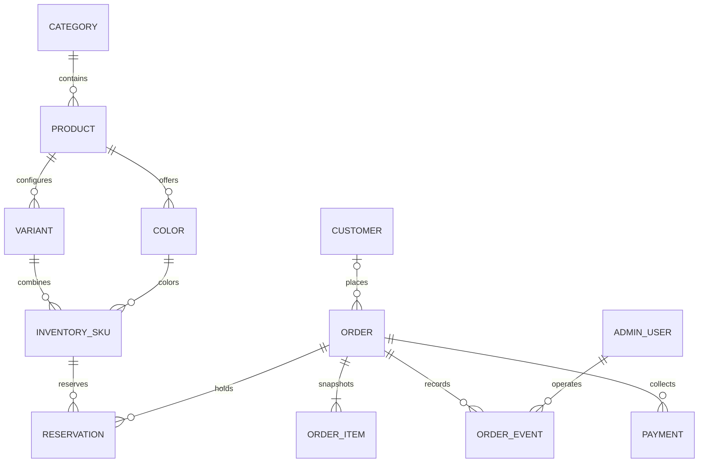

> B5.7 — 09/11/2026: [chuẩn bị GHCR](BACKEND_B5_REGISTRY.md) đã có workflow phát hành thủ công sau CI, lưu đúng image đã kiểm thử. CI 42623431005 đạt cả export/upload image; chưa merge main hoặc publish registry.

> Cập nhật 09/11/2026: [B5.6 CI](BACKEND_B5_CI.md) đã chạy đạt toàn bộ GitHub Actions trên Ubuntu tại commit `6c35852`: build Docker, frontend/deployment tests, 74 backend tests, 21 nhóm E2E và recovery. [Kết quả CI](https://github.com/VanHien1313/Website_Apple_v1/actions/runs/42620970687). [B5.3](BACKEND_B5_DOCKER.md) có 21 nhóm Docker E2E; [B5.4](BACKEND_B5_RECOVERY.md) đạt restart/backup/restore; [B5.5](BACKEND_B5_STAGING.md) chuẩn bị staging và preflight 6/6 test. Chưa có hạ tầng hosting/registry, chưa nghiệm thu TLS mạng thật hoặc triển khai public.

> Cập nhật25/10/2026: frontend đã có chế độ API cho catalog và phiên khách/admin trên SQL Server. Trạng thái, kiểm thử và phần còn lại: [B2 frontend](BACKEND_B2_FRONTEND.md). Nội dung tiến độ cũ phía dưới giữ làm lịch sử.

> Cập nhật24/10: đã chuyển nền backend sang **SQL Server** theo quyết định của người dùng. [Trạng thái và hướng dẫn hiện hành](SQL_SERVER_MIGRATION.md). Các mô tả PostgreSQL trong lịch sử B1 đã được thay thế.

# Bàn giao backend/database — 17/10/2026

Frontend demo đã có luồng xuyên suốt. Cập nhật 23/10/2026: nền tảng B1 đã triển khai trong backend/, xem [BACKEND_B1.md](BACKEND_B1.md) để biết kiểm thử và giới hạn PostgreSQL server chưa chạy. [API contract](API_CONTRACT.md) mô tả JSON, quyền, lỗi và phần adapter cần đổi. Không chuyển dữ liệu browser hoặc credential demo vào database thật.

## Mô hình quan hệ đề xuất

ORDER_EVENT có actorType và principal phù hợp khách/admin/system, không phải mọi sự kiện đều có admin. OrderItem giữ dữ liệu lịch sử, không cascade-delete khi xóa catalog. Schema B1 hiện dùng customer_id/admin_id với CHECK theo actor_type; xem backend/migrations/001_initial.sql.

| Bảng | Trường/chỉ mục chính | Ràng buộc |
| --- | --- | --- |
| categories | id PK, name, normalizedName unique | Xóa bị chặn khi còn sản phẩm |
| products | id PK, categoryId FK, slug unique, name, description, createdAt, updatedAt, active | Index(categoryId,active); archive thay xóa vật lý khi đã bán |
| variants/colors | id PK, productId FK, thuộc tính cấu hình/màu | ID phải thuộc cùng product |
| inventory_skus | id PK, variantId FK, colorId FK, sku unique, price, originalPrice, onHand, reserved, revision | unique(variantId,colorId); số nguyên không âm, reserved ≤ onHand |
| customers | id PK, normalizedEmail unique, fullName, phone, passwordHash, credentialVersion | Hash server; không trả hash qua API |
| admin_users | id PK, normalizedEmail unique, passwordHash, role, active | Không khóa/xóa owner cuối cùng; policy server |
| sessions | opaque session hash, principalId/type, expiresAt, revokedAt | Index thời hạn, thu hồi khi đổi mật khẩu |
| orders | id PK, orderCode unique, customerId nullable, snapshot khách/địa chỉ, status, paymentStatus, totals, createdAt, completedAt, revision | Index(customerId,createdAt), (status,createdAt), (completedAt,paymentStatus) |
| order_items | orderId FK, skuId nullable, snapshot tên/ảnh/cấu hình/màu/giá, quantity, totalPrice | Snapshot không thay đổi khi catalog sửa |
| order_events | orderId FK, actorType/id, kind, from, to, note, at | Append-only trong transaction cập nhật đơn |
| payments | orderId FK, method, status, amount, providerRef?, paidAt?, refundedAt? | COD trước; nếu gateway, idempotency riêng cho webhook |
| reservations | orderId FK, skuId FK, quantity, expiresAt, status | Giữ/trả tồn kho nguyên tử |
| idempotency_requests | scope, requestId, fingerprint, orderId, expiresAt | unique(scope,requestId); bảo vệ retry đồng thời |

Demo hiện cho chọn màu độc lập với variant và chỉ có inStock boolean. Cần map cặp variantId/colorId sang inventory SKU và cập nhật quote/PDP theo khả dụng từng cặp. Dùng integer/bigint/decimal(scale0) cho tiền, kiểm tra giới hạn safe integer trước serialize JSON.

## Các quyết định nghiệp vụ cần chốt

1. Doanh thu hiện là tổng đơn COMPLETED+PAID gồm ship, ghi nhận theo completedAt Việt Nam, refund loại khỏi kỳ gốc. Nếu cần kế toán/hoàn một phần, dùng ledger và thay báo cáo có chủ đích.
2. Phí standard hiện miễn khi tổng giá bán trên 10 triệu, còn lại 50.000đ; express 50.000đ. Đối chiếu `domain/cart.ts` và test mốc biên trước chuyển server.
3. Khách được hủy trước SHIPPED; không có trả hàng. Hoàn tất chỉ khi đã giao và đã thu tiền.
4. Auth khách là phần nâng cao đã có UI; guest checkout vẫn hoạt động. Đơn guest không tự nhận theo email.
5. Ảnh/thông số/tuyên bố bảo hành phải được duyệt. `newest` ở catalog hiện ưu tiên nhãn mới, chưa có ngày tạo thật. Không dùng fixture làm bằng chứng giá/thông số thương mại.

## Thứ tự triển khai đề xuất

**B1 — Khởi tạo server và database:** chốt Node/Express hoặc ASP.NET theo đề tài; migrations, seed giả, cấu hình môi trường, healthcheck và logging không ghi mật khẩu. Tạo schema, FK/unique/check constraints, transaction tests. Secret chỉ phía server.

**B2 — Catalog + authentication:** public catalog có pagination/filter/sort server, upload có kiểm tra loại/kích thước/quyền, admin auth/session/role, khách register/login/password, rate limit. Thay auth guard đồng bộ bằng provider có loading/401/error. Tách demo adapter khỏi build production.

**B3 — Checkout + vận hành:** quote canonical, idempotent create, snapshot đơn, stock reservation và rollback, guest receipt bảo vệ, ownership cho khách, optimistic concurrency/revision, append event. Test hai request đồng thời, giá đổi, hết hàng, DB fail và retry.

**B4 — Báo cáo + CRUD quản trị:** query phân trang thay read() toàn DB, admin user password thật, báo cáo đúng timezone/công thức đã chốt. Không cho frontend tự tính báo cáo từ toàn bộ đơn tải về.

**B5 — Tích hợp và triển khai:** HTTP adapters, lỗi field/401/403/404/409/422, kiểm thử E2E trên API thật, Docker Compose frontend/server/database, migration khi deploy, HTTPS, backup/restore, staging rồi hosting theo PDF.

Mỗi mốc nghiệp vụ cần test server và browser. B1 đã có test schema/HTTP bằng PGlite; kiểm chứng PostgreSQL server độc lập còn lại. B2–B5 chưa triển khai.

## Kịch bản bắt buộc khi thay mock

- Hai yêu cầu cùng idempotency key chỉ tạo một đơn; payload khác bị từ chối.
- Hai đơn tranh lượng tồn cuối cùng không bán vượt tồn; rollback không mất hàng.
- Giá/ship thay đổi yêu cầu người mua đồng ý lại; retry mạng không xóa giỏ sớm.
- Editor không sửa tài khoản admin; khách không đọc/hủy đơn của người khác; guest receipt không lộ qua mã đơn.
- Phiên hết hạn/đổi mật khẩu không cho tiếp tục mutation; HTTP lỗi không lộ dữ liệu nhạy cảm.
- Cập nhật stale revision trả409, không ghi đè lịch sử; hoàn thành/hủy/hoàn tiền đúng báo cáo tại mốc ngày Việt Nam.
- Reload/deep link SPA trên hosting hoạt động; API404 không bị fallback thành index.html.

## Phạm vi chưa xác nhận

Không chứng nhận WCAG, cross-browser/Safari, bảo mật production, hiệu năng mạng thực tế hoặc quyền sử dụng ảnh từ smoke test Chrome. Browser-local storage không là persistence server, không chống sửa dữ liệu hoặc đảm bảo transaction nhiều tab. Những giới hạn này phải được giải quyết/kiểm tra ở mốc tích hợp và trước công khai.
