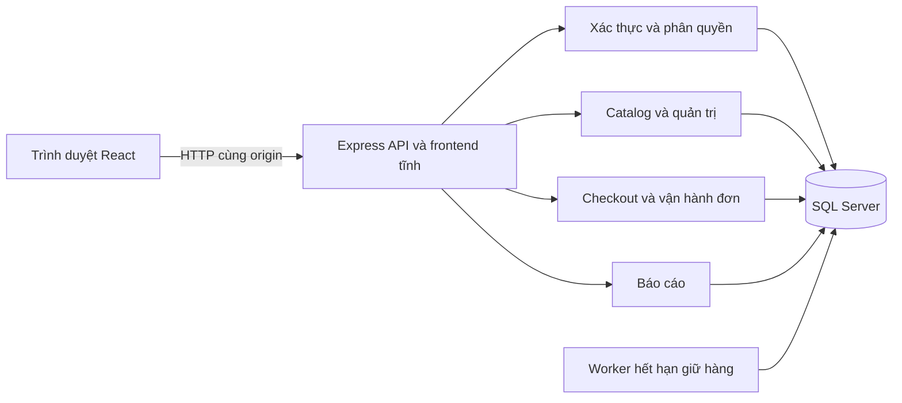
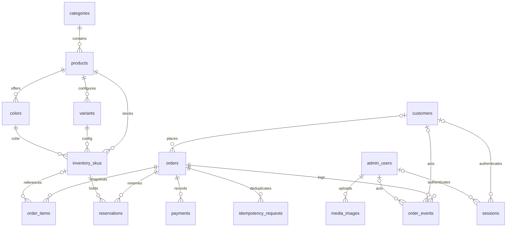
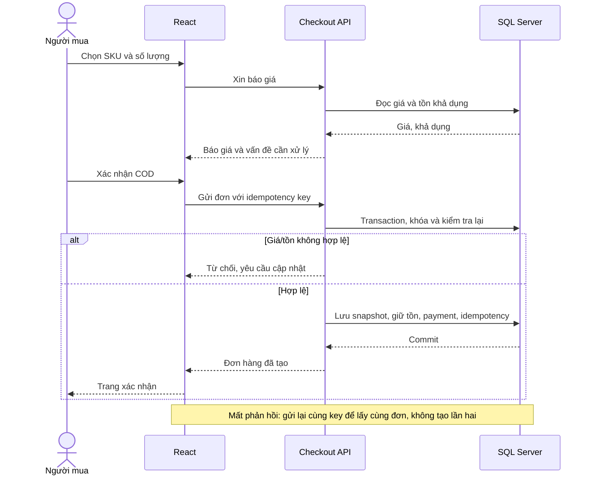
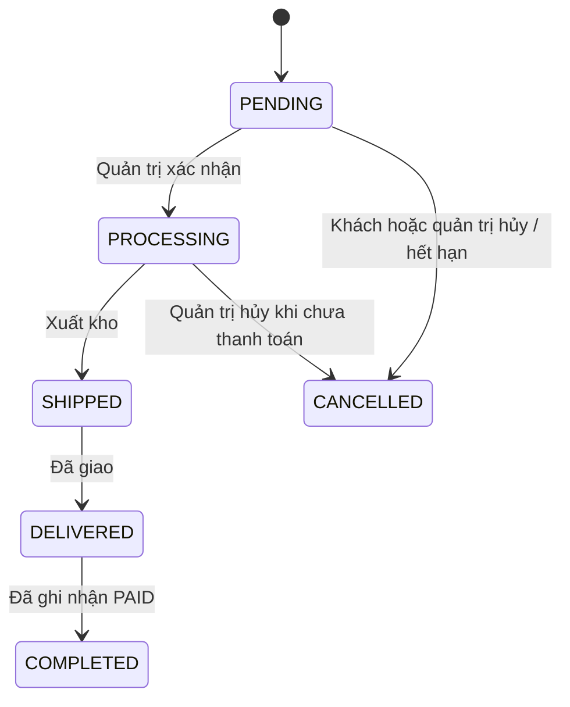

# Bản thảo báo cáo — Aura eCommerce

Ngày 10/11/2026. Đây là nội dung nền và sơ đồ có thể chỉnh sửa, **chưa phải cuốn báo cáo đã định dạng theo mẫu lớp**. Bổ sung tên môn, giảng viên, lớp, rubric và ảnh nghiệm thu trước khi in/nộp.

## 1. Nhóm và bài toán

Nguyễn Văn Hiền — N23DCAT023; Khuất Nguyễn Bảo Hiếu — N23DCAT026. Cả hai trực tiếp thiết kế và phát triển website. Aura là đồ án bán thiết bị Apple với catalog, cấu hình/SKU, tài khoản, đặt hàng COD, vận hành đơn, tồn kho và doanh thu.

Mục tiêu là xây luồng thống nhất từ tìm sản phẩm đến hoàn thành đơn, có phân quyền và lưu trữ SQL Server. Website phục vụ học tập, không tuyên bố là cửa hàng được Apple ủy quyền. Chi tiết yêu cầu/ngoại lệ xem ACCEPTANCE_SCOPE.md và LECTURER_REQUIREMENTS_MAPPING.md.

## 2. Kiến trúc

Frontend React/TypeScript/Vite sử dụng route API riêng, không bundle repository mock trong Docker. Backend Express dùng truy vấn tham số và transaction. SQL Server chứa tài khoản, catalog, đơn, lịch sử, ảnh và phiên. Compose local cung cấp db, init và app; runtime SQL dùng tài khoản hạn chế, app chạy user node. Staging có cấu hình chuẩn bị, chưa có URL triển khai thật.

## 3. Dữ liệu và quan hệ

ERD dưới đây rút gọn từ khóa ngoại migrations 001 và 002; không thể hiện toàn bộ cột/check/index. Cardinality thể hiện schema, không khẳng định mọi đơn bắt buộc đã có payment/event ở mọi thời điểm.

Session có đúng một principal customer hoặc admin. SKU buộc biến thể và màu cùng product bằng khóa ngoại ghép. `available = on_hand - reserved`; reserved không âm và không lớn hơn on_hand. Tiền là số nguyên VND, thời gian lưu UTC. Đơn giữ snapshot tên/giá/người nhận để thay đổi catalog về sau không sửa lịch sử mua hàng. `order_items.product_id` và `variant_id` là giá trị snapshot, không vẽ chúng thành FK không tồn tại.

Migrations 003 bổ sung receipt guest; các migrations tiếp theo củng cố xử lý đơn và version. Categories/products/admin_users có rowversion; các luồng đơn/SKU dùng revision. Khi báo cáo chi tiết, đối chiếu từng file migration thay vì sửa migration đã áp dụng.

## 4. Luồng checkout

Phí giao tiêu chuẩn miễn khi subtotal **lớn hơn** 10 triệu; bằng hoặc thấp hơn là 50.000 đồng. Giao nhanh 50.000 đồng. Tổng đơn bằng subtotal cộng phí ship, không trừ khoản chênh giá gốc lần hai. Thời gian giữ đơn PENDING chưa thanh toán tối đa 24 giờ.

## 5. Vòng đời đơn và tồn kho

CONFIRMED là trạng thái cũ có thể chuyển PROCESSING; sơ đồ rút gọn luồng mới. Khi tạo đơn: reserved tăng. Khi hủy: reserved giảm, on_hand không đổi. Khi SHIPPED: reserved và on_hand cùng giảm một lần. PAID là ghi nhận thu tiền COD sau giao hàng, không phải tích hợp cổng chuyển tiền. Chỉ COMPLETED + PAID được tính doanh thu theo completed_at, kỳ Việt Nam UTC+7, tuần bắt đầu thứ Hai.

## 6. Xác thực và nhất quán

Mật khẩu băm scrypt; phiên HttpOnly lưu token hash trong SQL. Đổi/reset password thu hồi phiên và tăng credential_version. Admin/customer dùng endpoint và cookie riêng. Frontend chọn loại tài khoản chỉ chọn luồng, không xác lập quyền. Backend kiểm tra chủ đơn, phiên và role ở thao tác tương ứng.

Mutation kiểm tra origin/header; các thao tác quan trọng dùng transaction và revision. Hai cập nhật cùng revision không cùng thắng. Lịch sử order_events chỉ append. Ảnh tải lên kiểm tra định dạng/kích thước rồi chuẩn hóa WebP. Chỉ mô tả những bảo vệ có trong code, không tuyên bố hệ thống miễn mọi lỗ hổng.

## 7. Kiểm thử, triển khai và đánh giá

Chèn kết quả hiện hành từ `docs/qa/docker-e2e/results.json`, ngày chạy, image ID tại deploy/image-lock.json và checklist manual của nhóm. Không dùng số test lịch sử thay bằng chứng bản cuối. Chèn ảnh catalog, chọn vai trò, profile, quản trị mobile, checkout, lịch sử đơn, báo cáo. Bộ test tích hợp dùng database cô lập rồi dọn, không seed dữ liệu test vào database người dùng.

Docker local và GHCR đã có nền tảng; hosting thực tế còn chờ hạ tầng. Bản local mới và registry cũ có thể khác nhau, phải dùng đúng manifest khi bàn giao. Sao lưu và khôi phục theo runbook hiện hành.

## 8. Giới hạn và hướng phát triển

Chưa có thanh toán online, OAuth, email tự động, CRUD role động, sửa/khóa customer, trả hàng/hoàn tiền qua UI. Có trang liên hệ email nhưng chưa có hệ thống ticket. Mục chưa chốt với giảng viên được ghi tại ACCEPTANCE_SCOPE.md. Các cải tiến tương lai phải có kiểm thử quyền, dữ liệu và migration tương ứng.

## 9. Hồ sơ cần bổ sung trước nộp

- Bìa/mục lục/trích dẫn đúng mẫu môn; phân công thực tế chi tiết hơn nếu giảng viên yêu cầu.
- Kết quả test tay, ảnh chụp phiên bản cuối, URL/source commit bàn giao.
- Xuất sơ đồ ra SVG/PDF và kiểm tra bản in rõ nét; Mermaid trong Markdown là nguồn chỉnh sửa, chưa phải minh chứng đã in.
- Slide/video thực tế và phần trình bày của từng thành viên; danh sách bài thực hành cá nhân.
